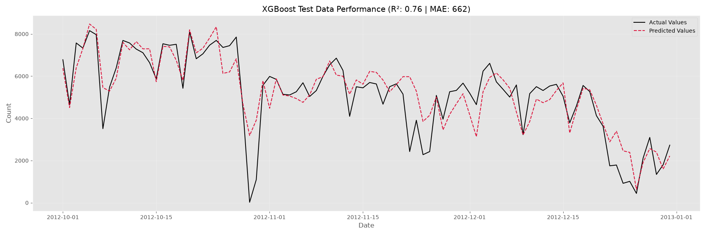
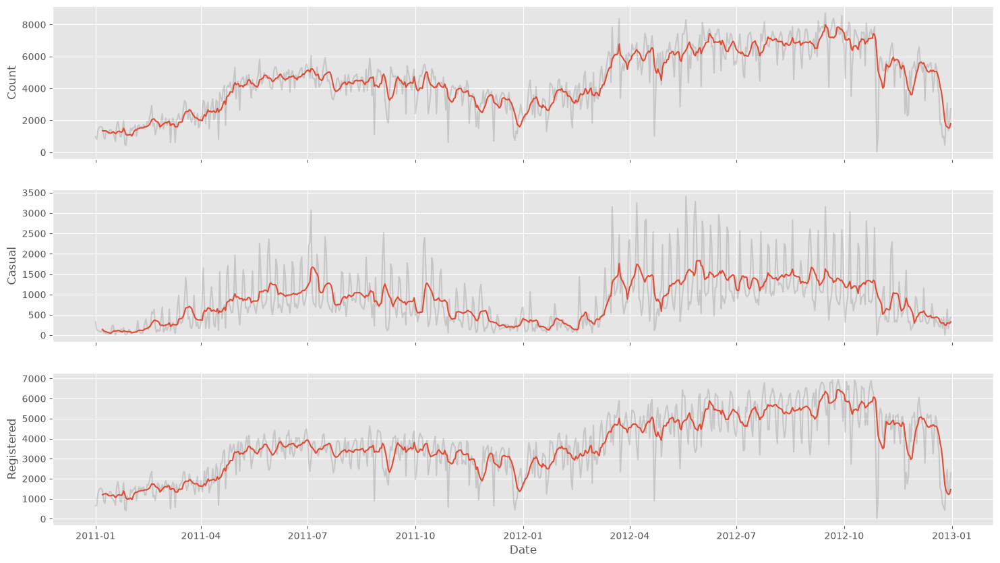
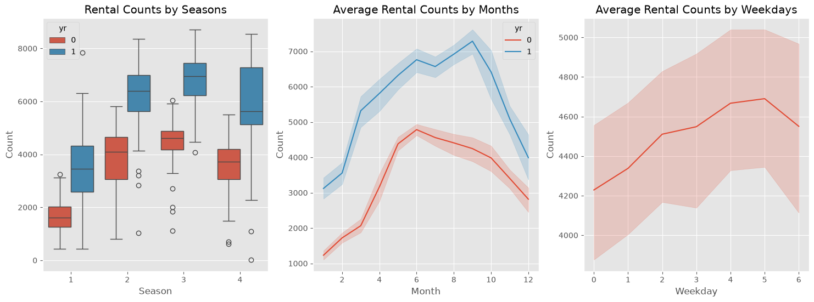
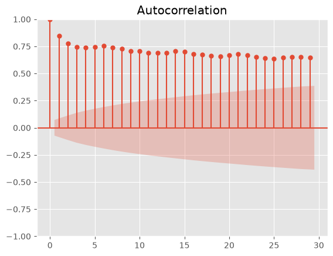
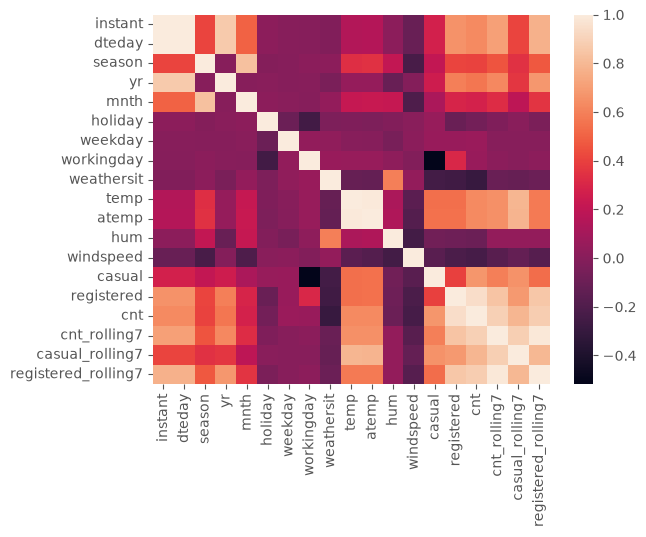

# Bike Sharing Demand Forecasting (Time Series ML)

An end-to-end, production-ready Time Series Machine Learning project designed to forecast daily bike rental demand (`cnt`) for the Washington D.C. Capital Bikeshare system.

The project strictly adheres to industry standards: **prevention of lookahead bias / data leakage**, structured **bottom-up feature aggregation** from hourly micro-data, a **benchmarking tournament** across model families, Bayesian hyperparameter optimization (**Optuna**), and disciplined **experiment tracking**.

---

## Key Highlights & Results

Through disciplined feature engineering and Bayesian hyperparameter tuning, model performance progressed steadily on the untouched hold-out test set (October – December 2012):

| Iteration | Model / Configuration | Test RMSE | Test MAE | Test R² |
| :--- | :--- | :---: | :---: | :---: |
| **Initial Tuned Baseline** | XGBoost (with initial lag features) | 1055.46 | 787.84 | 0.700 |
| **Bottom-Up FE** | + Rush Hour Bad Weather (17:00–19:00) | 1008.00 | 747.00 | 0.720 |
| **Optimal Rolling Model** | **Fine-Tuned XGBoost (Rolling + Rush Hour)** | **938.32** | **661.50** | **0.761** |

> **Business Impact:** During the test period (where average daily rentals were ~5,700), the final model achieved an average error of only **661.5 bikes (~11.6% MAPE)**, successfully explaining **76.1% of the total variance** on completely unseen future data.

### Model Predictions vs. Actual Demand
The fine-tuned model tracks both the underlying seasonal decline and high-frequency day-to-day demand shifts closely:



---

## Exploratory Data Analysis & Time Series Insights

Key exploratory analysis conducted prior to modeling:

### 1. Trend and User Segmentation (7-Day Moving Average)
Using 7-day rolling smoothing reveals a steady year-over-year growth from 2011 to 2012. Furthermore, casual users demonstrate high elasticity to weather and summer peaks, while registered users provide a steady, commuter-driven volume.



### 2. Seasonality & Calendar Distributions
Clear seasonal peaks in summer/early fall and valleys during winter. Comparing 2011 vs. 2012 illustrates strong macro-level adoption growth across all months.



### 3. Autocorrelation Analysis (ACF)
The ACF plot demonstrates strong persistence (slow decay indicating trend) along with distinct weekly seasonal spikes at lag 7, 14, 21, and 28, justifying the engineering of 7-day and 30-day rolling window features.



### 4. Correlation & Multicollinearity
Analysis identified near-perfect collinearity (~0.99) between `temp` and `atemp`. `temp` was dropped in favor of `atemp` (feeling temperature), which better explains human behavioral response.



---

## Engineering Methodology & Best Practices

1. **Anti-Leakage Safeguards:**
   - Shuffling is strictly forbidden; chronological train/test splits are used throughout.
   - All rolling and lag aggregations enforce `shift(1)` to ensure only strictly past information is used at forecast time $t$.
2. **Cross-Validation Strategy:**
   - Evaluated via expanding-window `TimeSeriesSplit` on training data.
   - Hold-out test set (October – December 2012, 92 days) remained sealed until final model evaluation to avoid test leakage.
3. **Bottom-Up Aggregation (Hourly to Daily):**
   - Extracted evening rush-hour weather severity (`rush_hour_bad_weather`, 17:00–19:00) from `hour.csv` to capture critical commute-window disruptions.
4. **Occam's Razor & Feature Selection:**
   - Empirical testing demonstrated that raw lag features (`cnt_lag1`) introduced split dilution and noise into shallow tree models. Relying purely on smoothed rolling indicators (`cnt_rolling7`, `cnt_rolling30`) delivered superior generalization on both CV and hold-out data.
5. **Experiment Tracking:**
   - Every feature hypothesis and tuning delta was logged in `experiment_log.txt` with Before/After metrics and operational decisions (`IN USE` / `NOT IN USE`).
6. **Clean Architecture:**
   - Modular, configuration-driven (`configs.yaml`) structure separating data loading, feature engineering, cross-validation, hyperparameter optimization, and evaluation.

---

## Project Structure

```text
├── configs.yaml           # Centralized configuration paths (data, model artifacts)
├── experiment_log.txt     # Scientific hypothesis and metric tracking log
├── requirements.txt       # Reproducible environment dependencies
├── .gitignore             # Ignored artifacts, virtual environments, data, and caches
├── notebooks/
│   └── 1.0-eda.ipynb      # Initial exploratory analysis and prototyping
├── reports/
│   └── figures/           # Visual artifacts (EDA and model evaluation curves)
└── src/
    ├── data/
    │   ├── load_data.py   # YAML-driven data ingestion
    │   └── split_data.py  # Chronological hold-out and feature/target splitting
    ├── features.py        # Cleaning, rolling features, and hourly aggregation pipeline
    └── train/
        ├── baseline.py    # Multi-model benchmarking tournament (Ridge, RF, LGBM, XGB)
        ├── tune.py        # Bayesian optimization with Optuna
        └── evaluate.py    # Final evaluation, metrics reporting, and model serialization
```

---

## Quick Start

### 1. Clone & Set Up Environment
```bash
git clone https://github.com/SmayNli/Bike-Sharing-Demand-Forecasting
cd bike-sharing-dataset
python -m venv .venv
source .venv/bin/activate  # On Windows: .venv\Scripts\activate
pip install -r requirements.txt
```

### 2. Run Model Benchmark Tournament
```bash
python -m src.train.baseline
```

### 3. Hyperparameter Optimization
```bash
python -m src.train.tune
```

### 4. Evaluate Final Model on Hold-out Test Set
```bash
python -m src.train.evaluate
```
